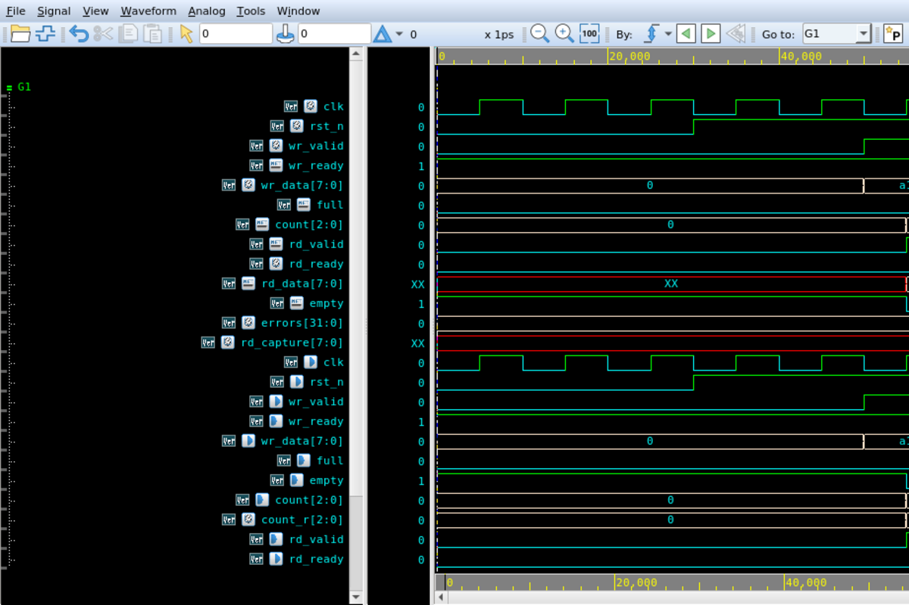
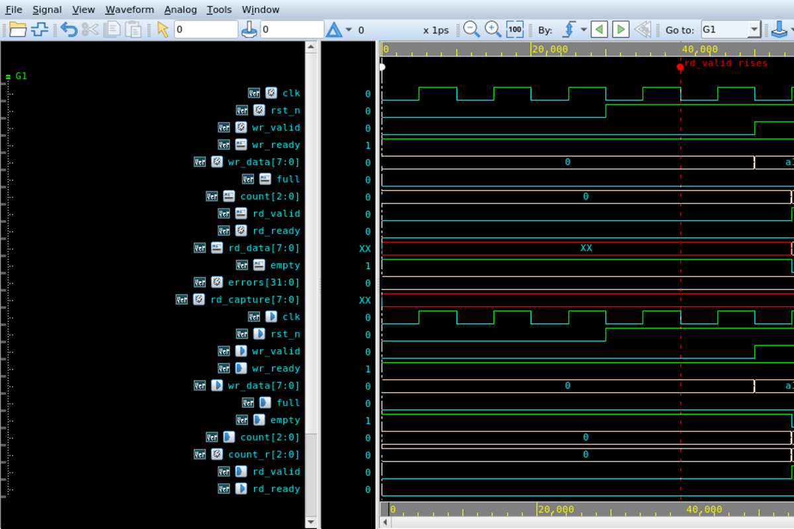
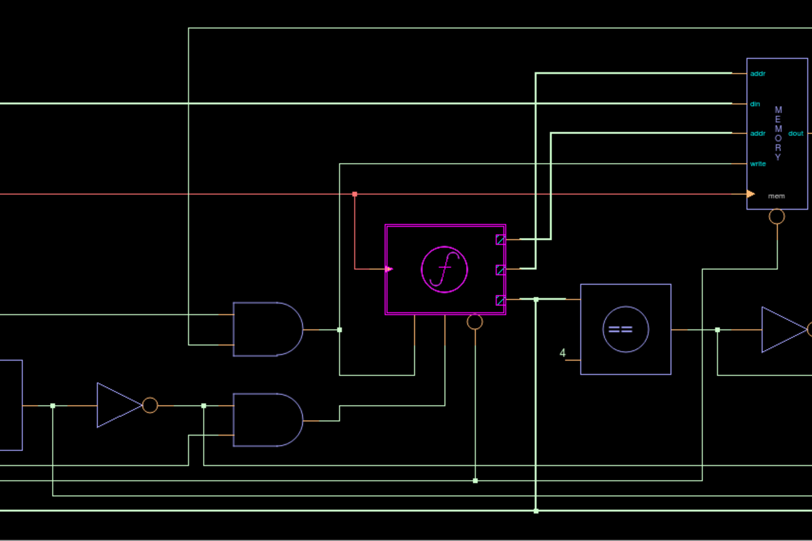
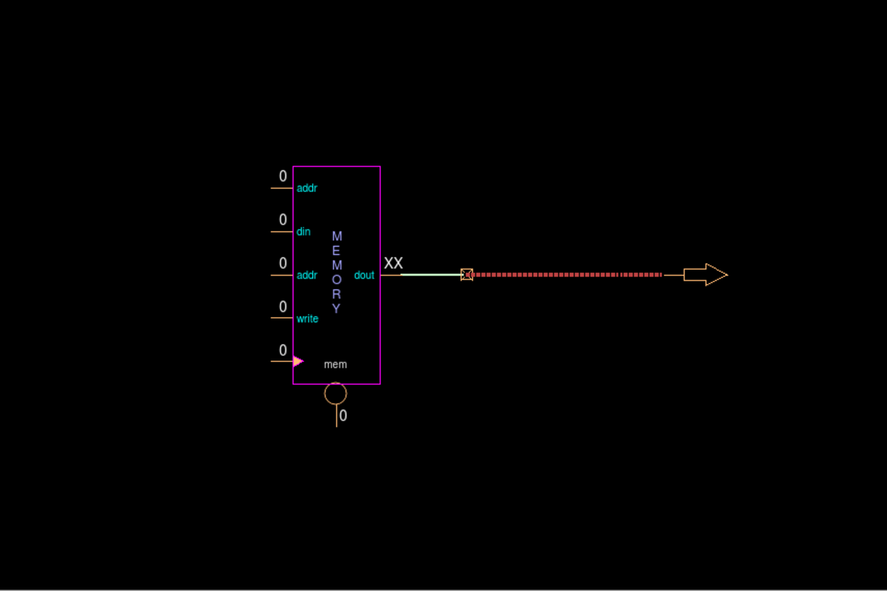

# verdimcp

**English** · [简体中文](README.zh-CN.md)

verdimcp connects Synopsys Verdi to an agent runtime.

The agent gets one typed surface over the tool: read values and edges, place signals, move the cursor,
trace drivers, capture a schematic cone or a screenshot, bundle the result into a report. The same tools
can drive the GUI you are watching, or run with no window at all.

39 tools · 12 skills · 97 end-to-end checks against a real GUI

## Static and dynamic

An agent can read a system specification, argue about a microarchitecture, and write the RTL that follows
from it. All of that is static: documents in, documents out, and the model is good at it.

What it cannot do is close the loop. The block it just wrote has behaviour, and that behaviour only exists
inside a simulation, in a waveform. The agent never sees it. So the next change is made against someone's
description of a picture, which is a summary of a summary.

This is also why nobody hands it the debug loop. Debugging means changing RTL based on what the signals
actually did. Without a way to look at the signals, "the agent will fix it" is an unsupervised guess with a
report attached.

It is why automated verification keeps stopping one step short as well. A regression tells you pass or
fail; debugging is the sequence after that. Find the cycle, follow the cause, propose a change, show that
the change fixed this and broke nothing else. Today that sequence has no observable process and no way to
check itself, so it stays with whoever can see the screen.

Closing the loop needs the dynamic half to be readable: values with units, edges with timestamps, structure
with provenance, and images produced by the tool rather than described by a person.

The waveform is only the first of those. Which cone drove the value, and which branch was active on that
cycle, sit in a schematic that until now only a person could open. A conclusion is easier to trust when its
marker sits in the window the engineer already has open, and it is worth little unless someone else can
re-run the query behind it. None of that schedules itself unless the session can be started, isolated and
stopped without a human.

verdimcp does those too. It opens a cone and captures it, writes native markers and comments into nWave
itself, bundles each finding with the exact call that produced it, and starts or stops sessions on its own
with a per-session lock so two agents cannot cross results.

That is what verdimcp is: one typed surface over a Verdi installation, explicit or headless, returning
results that can be re-run and evidence that can be reviewed.

## Explicit and headless

**Explicit.** What you ask for happens in your own window: create one, add signals, move the cursor,
place native markers and comments, capture the screen, open a schematic. Nothing happens off-screen, so
reviewing the agent's work means looking at the GUI you already have open.

**Headless.** No display needed. A separate Python process reads the FSDB directly: exact transitions, X/Z
sweeps, per-signal change counts, bounded waveform renders. This is the path for batch runs, CI, and
anything that has to finish without a person available.

Both are the same tool surface, and every query reports which one served it: `engine.used` with a short
reason, plus an `fsdb` block carrying `max_time` and `is_completed`. Transitions from the GUI come from
`wvSearchNextBySignal`, which skips glitches; the headless path does not.

There are no protocol names in verdimcp. The handshake primitives take roles (valid, ready, data, id,
last) and signal paths. Protocol rules are text in skills.

## What it looks like

| | |
|---|---|
|  |  |
|  |  |

## Tools

| Area | Tools |
|---|---|
| Session and window | `capabilities`, `sessions_list`, `session_info`, `session_start`, `session_stop`, `windows_list`, `window_create`, `window_raise`, `window_screenshot` |
| Waveform | `fsdb_open`, `signals_list`, `signals_add`, `signals_remove`, `cursor_set`, `value_get`, `transitions_get`, `xz_scan` |
| Design | `scopes_list`, `drivers_get`, `fanin_get`, `fanout_get`, `source_get`, `cone_capture` |
| Primitives | `signal_map_put`, `signal_map_get`, `signal_map_list`, `handshake_beats`, `change_stats`, `window_scan`, `check_define`, `check_run` |
| Evidence | `evidence_create`, `capture_annotate`, `waveform_render`, `evidence_add`, `waveform_compare`, `evidence_compare`, `evidence_report` |
| Escape hatch | `tcl_exec` (off unless `VERDI_ALLOW_RAW=1`, every command audited) |

Inputs, outputs and semantics: [docs/tools.md](docs/tools.md).

## Skills

Twelve markdown files. A skill is where the judgement sits: recognising which case you are in, choosing
the order of calls, and knowing what to say when the tool you want isn't available.

| Skill | Covers |
|---|---|
| `verdi` | routing, safety, which skill applies |
| `verdi-session-ops` | start/stop, several sessions, remote display, a dead GUI |
| `verdi-waveform` | values, edges, cursor, engine choice |
| `verdi-signal-map` | binding protocol roles to paths, and checking the binding |
| `verdi-bus-debug` | a handshake that's blocked, or a transfer that never landed |
| `verdi-xz-debug` | X/Z categories, first occurrence, root cause |
| `verdi-design-trace` | driver, load, fan-in/out, source |
| `verdi-cone-evidence` | capturing a cone and reading it without overclaiming |
| `verdi-temporal-pattern` | "A then B", sustained conditions, frozen checks |
| `verdi-regression-diff` | this run against the previous one |
| `verdi-evidence` | turning an investigation into something reviewable |
| `verdi-performance` | cost model, render bounds, what it won't answer |

More detail, including the routing graph: [docs/skills.md](docs/skills.md).

## Where it sits in a flow

```
spec ──► RTL ──► TB ──► simulate ──► debug ──► fix ──► sign-off
agent   agent   agent    agent        ▲                   ▲
                                     └── this project ───┘
```

The two marked steps are the ones an agent could not enter before. One is reading the failing cycle.
The other is producing something a reviewer accepts as proof that the fix worked, without a person
relaying what was on screen.

## Things it's been used for

**Chasing a stuck handshake.** Map the channel once with `signal_map_put`, then `handshake_beats` gives the
beats that actually completed, `window_scan` finds the first cycle where valid is up and ready isn't, and
`drivers_get` walks upstream until you reach the block that refused. Freeze the rule with `check_define` so
the same check can run after the next build.

**Finding where an X came from.** `xz_scan` over a scope gives candidates. `value_get` confirms the literal
value. `cone_capture(mode: "x", time)` opens the schematic at that timestamp, applies Verdi's own X trace,
and saves the picture. You still have to read the picture, but you can point at it in a review.

**Comparing two runs.** `waveform_compare` against the previous run's FSDB puts the same signal side by
side. For a number ("two cycles later"), pull `transitions_get` from each run and compare the timestamps.
The image shows the shape; the edge lists give the count.

**Handing off.** `capture_annotate` writes native nWave markers, comment boxes and highlights, then
screenshots. The engineer opens the same window and sees the same objects, so the screenshot and the claim
can't drift apart.

**Gating a nightly run.** `scripts/acceptance.sh` drives a real session through 97 checks and exits
non-zero on the first failure. It catches the things that break silently, like a signal path changing after
an RTL edit.

**Protocol work without a decoder.** A skill supplies the rules, verdimcp supplies sampling:

```
signal_map_put(axi_wr, {clock, valid, ready, data, id})
handshake_beats(axi_wr)                -> completed beats with payload
window_scan("awvalid && !awready")     -> first stall
check_define("axi4_aw_stable", ...)    -> re-runnable check
```

Swapping AXI for APB or a house handshake changes the map and a paragraph. Nothing in `mcp/` moves. The
bus-debug skill carries rule text for AXI4, AXI4-Lite, AXI4-Stream, APB, AHB and Wishbone, and still has no
decoder in it.

## Numbers

903 MB FSDB, 128 signals, 2000 bins, 5 ms of simulated time:

| Path | Total | Breakdown |
|---|---:|---|
| NPI, one-shot process | 30.6 s | 4.0 init, 18.1 read, 0.1 svg, 8.3 png |
| NPI, resident reader | ~26 s | init paid once, hot queries 0.6-1.3 s |
| GUI, first capture | 27.0 s | 11.4 open, 4.1 screenshot, rest is setup |
| GUI, same window again | 9.7 s | capture only |

Headless isn't automatically faster. NPI wins on narrow reads; the GUI wins on wide views. `waveform_render`
is capped at 16 signals and 1000 bins for that reason, and a query that runs long comes back with a
`switch_hint` naming the other engine.

Both paths sat around 8 GB RSS on that file. The FSDB index dominates, and headless doesn't help.

## Known limitations

All of these were tried on `W-2024.09-SP1`, and the tools report them instead of guessing:

- Multi-level cones have no pin list. `schTrace*ByLevel` results are rejected by `schDumpTracedLeafPin`.
  The tools return `cone_paths` and `degraded: true`.
- X, active and multi-level cones are images only. `schCapture` works; there is no text dump.
  `text_available` is always `false`.
- Waveform comparisons are images only. `wvCompareResult` wants a second waveform pane, and that pane can't
  be created from Tcl.
- Temporal Flow View can't be opened from a script. `tfgNewViewer` returns 0 unless a TFV window already
  exists.
- Running a comparison after opening schematic windows killed Verdi once during development. The tool warns
  when schematic windows are present, and the skills say to compare first or use a fresh session.
- A live FSDB only shows what's been flushed. `$fsdbDumpflush` every 1024 cycles behaved; without it, VCS
  buffered and a 7 KB file already reported the full time range.

Table with commands and evidence: [docs/limits.md](docs/limits.md).

## Install

You need Verdi with `libnclt` (the `-serverPort` channel), Bun, Python 3 with `pynpi`, and an X
display for the GUI half. Tested on `W-2024.09-SP1`.

```bash
# Source your own environment first. The repo has no vendor paths in it.
source /path/to/your/env.rc

bash bin/build.sh
bash bin/install.sh
```

Register verdimcp with your MCP client:

```json
{"mcpServers": {"verdi": {"command": "bun", "args": ["run", "mcp/src/server.ts"], "cwd": "/path/to/verdimcp"}}}
```

```bash
verdi-session start --detach --label demo -- -f demo/sim/filelist.f -ssf demo/sim/sync_fifo.fsdb
bash scripts/acceptance.sh     # optional: 97 checks, starts and stops its own Verdi
```

The scripts require `VERDI_HOME` and `DISPLAY` and stop with a message if your environment isn't sourced.
Client setup and the three session flavours (`-ssf`, `-f`, `-dbdir`) are in
[docs/getting-started.md](docs/getting-started.md).

## Layout

```
bin/        verdi-session: registry, per-session flock, JSON in/out
mcp/        Bun + TypeScript, 39 tools, resident NPI worker
skills/     12 markdown decision flows
scripts/    acceptance, lifecycle, concurrency, live-FSDB, remote checks
demo/       sync_fifo RTL/TB, big-FSDB generator, long-running writer
docs/       architecture, tools, skills, evidence, limits
```

## Conventions

- verdimcp returns facts. Skills decide what they mean.
- A conclusion is labelled `VERIFIED` (a tool was called), `INFERRED` (read off an image or a correlation),
  `DOCUMENTED_ONLY`, or `NOT_TESTED`.
- `not_supported` means Verdi won't hand it over. It isn't something to route around.
- Read-only by default. Anything that changes the GUI is a separate tool.
- Only sessions in your own registry, with a matching `-serverPort`, are touched.
- `AGENTS.md` has the rest, and it applies to humans too.

## Contributing

Issues and PRs are fine. Read [AGENTS.md](AGENTS.md) first. The short version: write down decisions in
`docs/` as you make them, back claims with a tool call, and check whether a skill can express the feature
before adding a tool.

## License

MIT. See [LICENSE](LICENSE).
