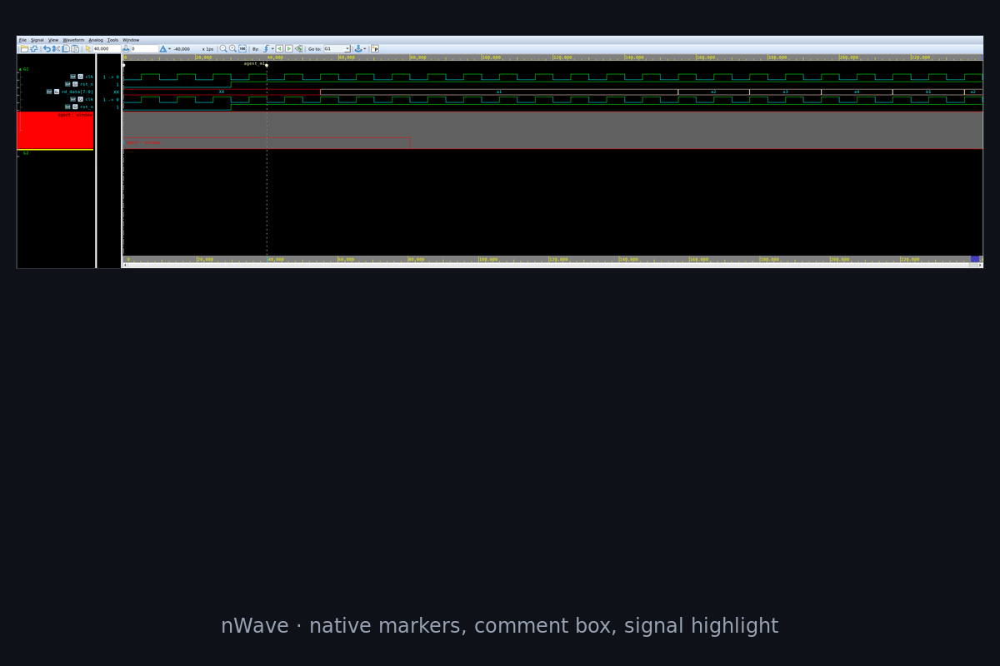
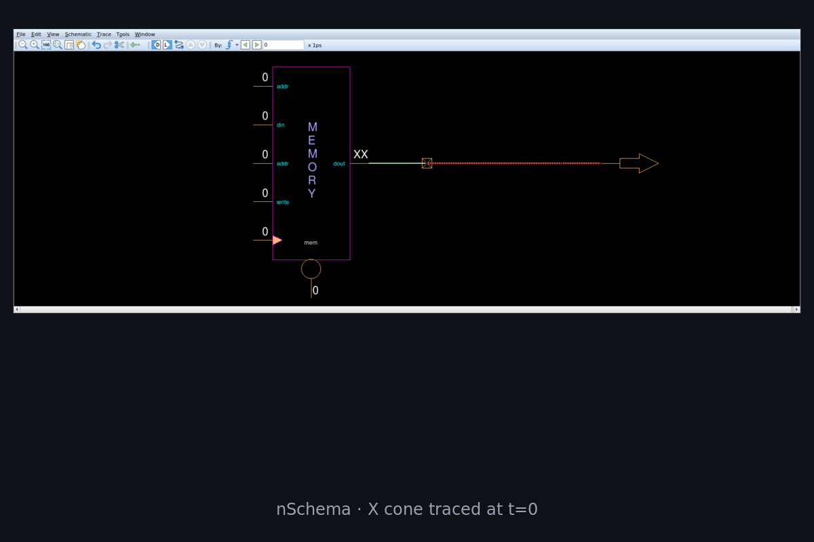
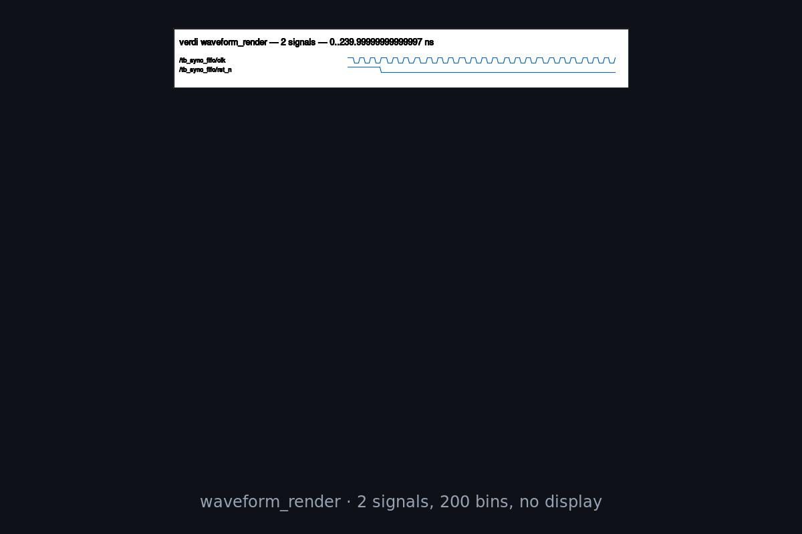
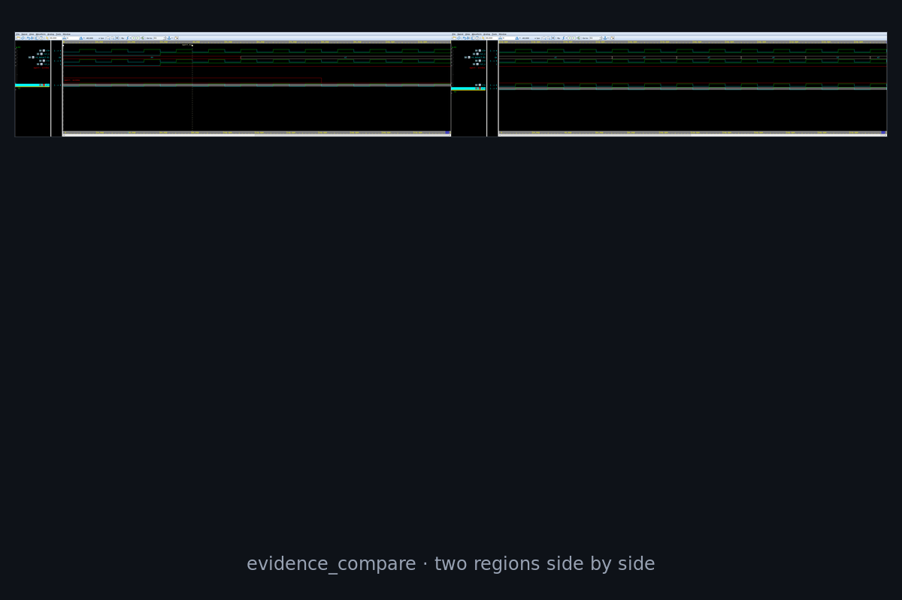

# verdimcp

[English](README.md) · **简体中文**

verdimcp 把 Synopsys Verdi 接进你的 agent runtime。

agent 拿到一套强类型接口：读值和 transition、加 signal、移 cursor、追 driver、截 cone 或整屏，最后把结论
打成 report。同一套工具既能操作你正看着的 GUI，也能在完全没有窗口的情况下跑。

39 个 tool · 12 个 skill · 97 项真实 GUI 端到端检查

## 静态与动态

agent 已经能读系统规格、参与微架构讨论、写出对应的 RTL。这些都是静态的：文档进，文档出，模型在这件事上
很强。

它做不到的是闭环。刚写出来的模块是有行为的，而行为只存在于仿真里、存在于 waveform 里。agent 看不到。于是
下一次改动是照着"别人对某张图的描述"提的，那是摘要的摘要。

这也是为什么没人敢把 debug 交给它。debug 的本质是照着 signal 实际做了什么去改 RTL。看不到 signal，
"agent 会修好"就只是一次没有监督的猜测，外加一份好看的 report。

自动验证始终差那一步，原因相同。回归只告诉你过还是不过；真正的 debug 是它后面那段：找到那一拍、顺着
cause 走、提出改动、证明改动修好了而且没弄坏别的。这一段今天没有可观察的过程，也没有自证的办法，所以只能
留给看得见屏幕的人。

要闭环，动态那一半必须可读：带单位的值、带时间戳的 edge、带出处的结构，以及由工具生成而不是由人转述的图。

waveform 只是第一条。哪个 cone 驱动了这个值、那一拍走的是哪个 branch，在 schematic 里，而 schematic 以前
只有人能打开。一条结论，如果 marker 就摆在工程师本来就有的那块屏上，信任成本会低很多；而只有别人能重跑出
它的那次 query，它才算数。这些又都排不进任务，除非 session 本身能无人值守地起、隔离、停。

这些事 verdimcp 都做了。它开 cone 并截图，把原生 marker 和 comment 直接写进 nWave，把每条结论和产生它的
那次调用一起打包，还能自己起停 session，用 per-session 锁保证两个 agent 不会串结果。

verdimcp 就是这样一个东西：覆盖一整套 Verdi 安装的强类型接口，显式能跑，headless 也能跑；结果可重跑，
evidence 可复核。

## 显式辅助与 headless

**显式辅助操作。** 你让它做什么，就在你自己那个窗口里发生：建窗、加 signal、移 cursor、打原生 marker
和 comment、截图、开 schematic。没有藏在后台的动作，所以复核 agent 干的事，就是看它把你那块屏改成了什么样。

**headless 分析。** 不需要 display。另起一个 Python 进程直接读 FSDB：精确 transition、X/Z 扫描、每个
signal 的变化计数、有界的 waveform render。批次跑、CI、以及任何必须在没人可用时完成的场景走这条。

两条路是同一套工具，而且每次 query 都会报告走了哪条：`engine.used` 加一句理由，外加 `fsdb` 块
（`max_time` / `is_completed`）。GUI 的 transition 来自 `wvSearchNextBySignal`，会跳过 glitch；无头这条不会。

verdimcp 里没有任何协议名。handshake 类原语只认 role（valid / ready / data / id / last）和 path，协议规则
是 skill 里的文字。

## 长什么样

| | |
|---|---|
|  |  |
|  |  |
|  | |

## 工具

| 分类 | 工具 |
|---|---|
| session / window | `capabilities`、`sessions_list`、`session_info`、`session_start`、`session_stop`、`windows_list`、`window_create`、`window_raise`、`window_screenshot` |
| waveform | `fsdb_open`、`signals_list`、`signals_add`、`signals_remove`、`cursor_set`、`value_get`、`transitions_get`、`xz_scan` |
| design | `scopes_list`、`drivers_get`、`fanin_get`、`fanout_get`、`source_get`、`cone_capture` |
| primitive | `signal_map_put`、`signal_map_get`、`signal_map_list`、`handshake_beats`、`change_stats`、`window_scan`、`check_define`、`check_run` |
| evidence | `evidence_create`、`capture_annotate`、`waveform_render`、`evidence_add`、`waveform_compare`、`evidence_compare`、`evidence_report` |
| 逃生口 | `tcl_exec`（默认关闭；设 `VERDI_ALLOW_RAW=1` 才启用，每条命令进 audit log） |

输入输出和语义：[docs/tools.md](docs/tools.md)。

## Skills

`skills/` 下是 12 个 markdown 文件。它们管的是判断：现在属于哪一类问题、按什么顺序调 tool、要的东西拿不到
时该怎么说。比如查 X 的那个 skill，会在调 tool 之前先让你分类：没驱动、没初始化、tri-state，还是传播。
分完类才去 scan，再决定要不要开 cone 看图。

路由图和每个 skill 的全文：[docs/skills.md](docs/skills.md)。

| Skill | 管什么 |
|---|---|
| `verdi` | 路由、安全、该用哪个 skill |
| `verdi-session-ops` | 起停、多 session、远程 display、GUI 挂了 |
| `verdi-waveform` | 值、transition、cursor、engine 选择 |
| `verdi-signal-map` | 把协议 role 绑到 path，并验证绑定 |
| `verdi-bus-debug` | handshake 卡住，或者传输根本没到 |
| `verdi-xz-debug` | X/Z 分类、首次出现、root cause |
| `verdi-design-trace` | driver、load、fan-in/out、source |
| `verdi-cone-evidence` | 截 cone、读 cone，别过度解读 |
| `verdi-temporal-pattern` | "A 之后 B"、持续条件、把规则固化成 check |
| `verdi-regression-diff` | 这次和上次比 |
| `verdi-evidence` | 把一次调查变成别人能复核的东西 |
| `verdi-performance` | 成本模型、render 边界、哪些它不回答 |

## 在流程里的位置

```
规格 ──► RTL ──► TB ──► 仿真 ──► debug ──► 修复 ──► 验收
agent   agent   agent   agent     ▲                  ▲
                                  └── 本项目 ────────┘
```

标出来的这两步是 agent 之前进不去的：读失败的那一拍；以及拿出别人愿意认的证明，而不是靠人转述屏幕上
有什么。

## 几个实际用法

**追一个卡住的 handshake。** 用 `signal_map_put` 把 channel 映射一次，`handshake_beats` 给出真正完成的
beat，`window_scan` 找出第一个 valid 拉高但 ready 没跟的周期，`drivers_get` 一路往上游走，直到走到那个
拒绝的模块。规则用 `check_define` 固化，下次构建后还能重跑同一个 check。

**查 X 是从哪来的。** `xz_scan` 在一个 scope 里给候选，`value_get` 确认字面值，
`cone_capture(mode: "x", time)` 在那个时刻开 schematic、施加 Verdi 自己的 X trace、存图。图还是得人看，
但评审的时候能指着它说话。

**比两次 run。** `waveform_compare` 指向上一次的 FSDB，同一个 signal 并排看。要具体到"晚了两个周期"，
就各自拉一次 `transitions_get` 对时间戳。图给形状，transition 列表给数量。

**交接给人。** `capture_annotate` 写的是 nWave 原生的 marker、comment box、highlight，然后截图。工程师
打开同一个窗口看到的就是这些对象，截图和结论不会各说各话。

**当夜间任务的闸门。** `scripts/acceptance.sh` 驱动一个真 session 跑 97 项检查，第一处失败就非零退出。它能
抓到那种悄悄坏掉的东西，比如 RTL 改完之后某条 signal path 变了。

**不写 decoder 也能做协议检查。** 规则由 skill 提供，采样由 verdimcp 提供：

```
signal_map_put(axi_wr, {clock, valid, ready, data, id})
handshake_beats(axi_wr)                -> 完成的 beat 和 payload
window_scan("awvalid && !awready")     -> 第一个 stall
check_define("axi4_aw_stable", ...)    -> 可重跑的 check
```

换成 APB 或者自家 handshake，改的是映射和一段文字，`mcp/` 里一行都不用动。bus-debug skill 里写了 AXI4、
AXI4-Lite、AXI4-Stream、APB、AHB、Wishbone 的规则文本，但里面没有任何 decoder。

## 耗时

903 MB FSDB，128 个 signal，2000 bins，5 ms 仿真时间：

| 路径 | 总耗时 | 拆解 |
|---|---:|---|
| NPI，单次进程 | 30.6 s | 4.0 init，18.1 read，0.1 svg，8.3 png |
| NPI，常驻 reader | ~26 s | init 只付一次，热 query 0.6–1.3 s |
| GUI，首次截图 | 27.0 s | 11.4 打开，4.1 截图，其余是准备 |
| GUI，同窗口再截 | 9.7 s | 只剩截图 |

无头不会自动更快。NPI 赢在窄范围读取，GUI 赢在大范围视图。所以 `waveform_render` 卡在 16 个 signal、
1000 bins；跑久了的 query 会带一个 `switch_hint`，告诉你换另一个 engine。

这两条路在这个文件上都是 8 GB 左右的 RSS，主要是 FSDB 索引占的，无头并不能省。

## 已知的限制

下面这些都在 `W-2024.09-SP1` 上试过，tool 会直接告诉你，而不是猜一个：

- 多级 cone 没有 pin 列表。`schTrace*ByLevel` 的结果会被 `schDumpTracedLeafPin` 拒掉，tool 返回
  `cone_paths` 和 `degraded: true`。
- X cone、active cone、多级 cone 只有图。`schCapture` 能用，但没有文本导出，`text_available` 恒为
  `false`。
- waveform 对比也只有图。`wvCompareResult` 要第二个 waveform pane，而那个 pane 没法从 Tcl 建。
- Temporal Flow View 开不出来。没有现成 TFV 窗口时，`tfgNewViewer` 返回 0。
- 开过 schematic 窗口之后再跑对比，开发过程中把 Verdi 弄挂过一次。tool 检测到 schematic 窗口会告警，
  skill 要求先对比、或者换新 session。
- 正在写的 FSDB 只给已 flush 的部分。每 1024 拍 `$fsdbDumpflush` 时行为正常；不 flush 的话 VCS 会缓冲，
  7 KB 的文件也能报出全时长。

带命令和 evidence 的表：[docs/limits.md](docs/limits.md)。

## 安装

需要带 `libnclt`（`-serverPort` 通道）的 Verdi、Bun、带 `pynpi` 的 Python 3，以及给 GUI 那一半用的 X
display。验证版本 `W-2024.09-SP1`。

```bash
# 先 source 你自己的环境。仓库里没有厂商路径。
source /path/to/your/env.rc

bash bin/build.sh
bash bin/install.sh
```

在 MCP 客户端里注册 verdimcp：

```json
{"mcpServers": {"verdi": {"command": "bun", "args": ["run", "mcp/src/server.ts"], "cwd": "/path/to/verdimcp"}}}
```

```bash
verdi-session start --detach --label demo -- -f demo/sim/filelist.f -ssf demo/sim/sync_fifo.fsdb
bash scripts/acceptance.sh     # 可选：97 项检查，会自己起、自己停一个 Verdi
```

脚本要求 `VERDI_HOME` 和 `DISPLAY`，环境没 source 会直接报错退出。客户端配置和三种 session
（`-ssf` / `-f` / `-dbdir`）在 [docs/getting-started.md](docs/getting-started.md)。

## 目录

```
bin/        verdi-session：registry、per-session flock、JSON 进出
mcp/        Bun + TypeScript，39 个 tool，常驻 NPI worker
skills/     12 个 markdown 决策流程
scripts/    acceptance、lifecycle、concurrency、实时 FSDB、remote 检查
demo/       sync_fifo RTL/TB、大 FSDB 生成器、长时间写入仿真
docs/       architecture、tools、skills、evidence、limits
```

## 约定

- verdimcp 只给事实，含义由 skill 判断。
- 结论贴标签：`VERIFIED`（调过 tool）、`INFERRED`（从图或相关性读出来的）、`DOCUMENTED_ONLY`、
  `NOT_TESTED`。
- `not_supported` 的意思是 Verdi 不给，不是让你绕过去。
- 默认只读；会改 GUI 的都是单独的 tool。
- 只碰自己 registry 里、cmdline 带匹配 `-serverPort` 的 session。
- 其余在 `AGENTS.md`，它对人也一样有效。

## 参与

欢迎 issue 和 PR，先读 [AGENTS.md](AGENTS.md)。简短版：决定写进 `docs/`，结论要有 tool 调用背书，加 tool
之前先想想能不能用 skill 表达。

## License

MIT，见 [LICENSE](LICENSE)。
