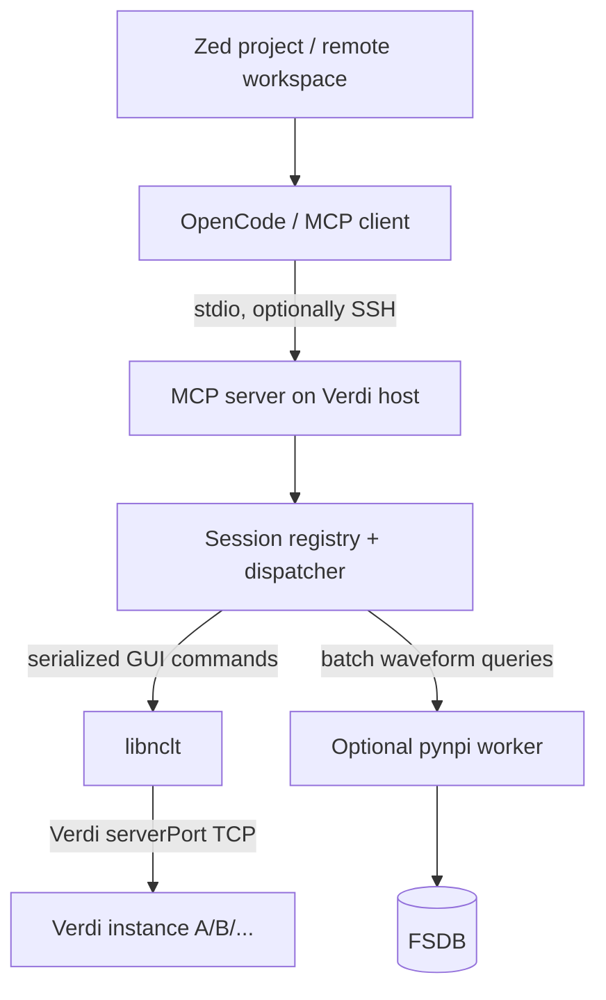

# Verdi MCP 整体架构设计

> 2026-10-17 · v0.1 · 方案草案，基于已验证的 libnclt PoC

## 目标

让 OpenCode 等 AI Agent 通过 MCP 安全地控制现有 Verdi/nWave 会话，读取波形与 RTL 上下文，协助 ASIC debug；适用于 Zed + OpenCode 的远程开发工作流，并支持团队低摩擦安装。**不要求替换 Verdi GUI**，而是使 Agent 能观察、导航和分析 GUI 所代表的调试现场。

## 当前状态与边界

- 已在 f29 上验证：通过 `libnclt` 连接 Verdi 的 TCP `serverPort`，执行打开 FSDB、添加信号、游标/时间窗口操作、窗口与截图等。
- 待实现：动态 session discovery、可靠的多 Verdi 选择、完整 MCP 接口、团队分发、并发/异常控制。
- 批量波形分析建议另加 `pynpi` Reader；其研究与测试计划见 `04-npi-research.md`。尚未在 f29 验证。
- 不应把 GUI Socket 延迟与 NPI FSDB 查询性能直接等同。

## 端到端架构

### 部署模式

**OpenCode 运行在远程服务器**：直接启动远程 MCP stdio 进程。**OpenCode 运行在本地**：通过 SSH 执行远端 MCP launcher，以 SSH 标准输入/输出承载 MCP。不能仅因为 Zed 打开了远程文件，就假定 OpenCode MCP 进程也自动运行在远端。启动器应从项目配置或远程开发上下文确定主机，不将 `f29` 硬编码。

## Session Discovery

- 由 launcher/registry 枚举当前用户可访问的 Verdi 进程及其 `serverPort`；记录 `host`、`user`、`pid`、`port`、`session_id`、启动时间和可选的 FSDB 路径。
- 动态端口不能视作稳定身份：进程重启或端口复用后需重新握手确认。
- 一个 MCP server 可管理多个 Verdi session；显式 `list_sessions`、`select_session`、`session_status`。
- 默认可选择唯一会话；存在多个候选时应要求明确选择，避免误操作。
- 注册表和 session metadata 限定为当前用户可读写；不得扫描或接管其他用户会话。

## MCP 工具设计

| 分类 | 建议工具 | 说明 |
|---|---|---|
| 会话 | `list_sessions`, `select_session`, `session_status` | 显式目标会话 |
| GUI | `open_fsdb`, `add_signals`, `set_cursor`, `set_time_window` | 改变 GUI 状态 |
| GUI 观察 | `list_displayed_signals`, `capture_waveform` | 截图/当前视图 |
| 波形 | `sample_signals`, `get_value_changes`, `count_changes`, `sample_on_clock` | 初版 GUI，后续按策略接 NPI |
| RTL | `trace_driver`, `goto_source`, `read_source` | 依赖 Verdi API 能力，逐项验证 |
| 诊断 | `health`, `capabilities` | 版本、引擎、许可和连接状态 |

工具输入采用结构化 schema；输出包含 `session_id`、请求 ID、时间单位、结果来源、错误/截断信息。危险或耗时操作设置预算，避免 Agent 无界遍历所有信号。

## 并发与一致性

- 对每个 Verdi 实例建立独立串行队列；`libnclt` 请求和响应严格配对，禁止多个并发调用混淆 socket 返回。
- 不同 Verdi 实例可并行；NPI worker 与 GUI 队列分离，但须限制并发与内存。
- 多个 Agent 对同一 GUI 操作不构成事务；每次修改前校验 session 身份，必要时返回冲突或要求重新读取状态。
- GUI 会话关闭、端口失效、超时后不得无条件重放有副作用的命令；先确认是否已执行。

## 安全与可维护性

- 只连接当前用户授权的本地/远端 Verdi；避免暴露 TCP listener 到公共网络。
- MCP 不默认提供任意 Tcl 或 shell 执行工具；路径读取限定在项目允许的 FSDB/source/log 根目录。
- 所有请求记录目标 session、工具名、耗时与结果状态；日志不默认记录完整设计敏感数据。
- 项目配置优先，环境变量次之；不要把特定主机、端口、个人路径写死在仓库中。
- 团队安装目标：OpenCode skill + MCP launcher + 自动依赖检查；启动器报告 Verdi/libnclt/pynpi 可用能力。

## 交付里程碑

1. **M0：现有 PoC 固化**：最小 libnclt adapter、命令/响应 schema、错误处理。
2. **M1：会话管理**：自动发现动态端口、多实例选择、断线检测、每会话串行化。
3. **M2：MCP 与远程启动**：本地 OpenCode→SSH→远端 MCP；远端 OpenCode 直连；OpenCode skill/配置。
4. **M3：调试工作流**：日志定位错误时间、查看关键波形、添加信号、跳转 RTL、截图回传。
5. **M4：NPI 混合引擎**：根据独立调研文档的 f29 验证结果决定接入和路由。
6. **M5：团队试用**：多用户/多 Verdi 稳定性、权限、性能、可安装性测试。

## 关键验收场景

- 一个用户同时开两个 Verdi，Agent 能正确列出并选择目标。
- 同一个 Verdi 上两个 Agent 发命令不会出现返回错配。
- GUI 重启后旧端口不会被当作同一会话。
- 本地 OpenCode + Zed 远程项目能够稳定控制 f29 上的 Verdi。
- 一个真实 RTL bug 从日志时间点导航到波形、RTL 证据链。
- NPI 不可用时 GUI 工具仍正常工作。

## 关联文档

- `04-npi-research.md`：Synopsys NPI 调研、性能、授权、混合路由及 f29 验证。
- [参考项目 verdi_bridge](https://github.com/RuihongY/verdi_bridge)：已有 GUI Tcl + Headless NPI 双路径实现。
